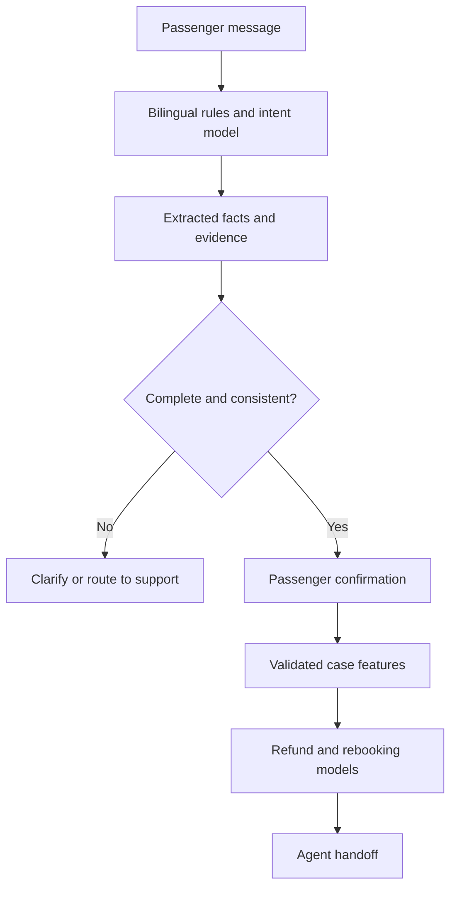

# FlightBridge

Bilingual passenger intake and machine-learning decision support for airline schedule changes.

FlightBridge turns a passenger message into reviewable case facts, asks for confirmation, and produces separate predictions for the recorded refund and rebooking outcomes. It combines the tabular modelling work in this repository with the English/Greek extraction logic from [the original pre-chat prototype](https://github.com/dimitrisrep/hackathon/tree/main/Schedule_change_AI).

This is a portfolio research prototype. The supplied case labels have not been verified against current airline policies, and the system does not execute bookings or refunds.

## Capabilities

- English and Greek intent/entity extraction with negation, conflicting-request handling and evidence.
- A supervised word/character TF-IDF intent baseline, explicitly trained on synthetic demo fixtures.
- Independent refund and rebooking classifiers selected from a majority baseline, logistic regression, random forest and a small MLP.
- Grouped development cross-validation and a separate holdout that keeps identical predictor combinations together.
- A common validation contract for the CLI, FastAPI service and plain Streamlit demo.
- Confirmation before predictions, derived schedule categories, unknown-carrier review and source-linked handoff data.
- Reproducible metrics, dataset fingerprints, tests, Docker configuration and CI definitions.

## Architecture



The NLP component identifies what the passenger is asking. It does not assign entitlement labels. The tabular models receive confirmed facts only; outcomes such as `solution`, `pap_request` and rejection reasons never enter the predictor matrix.

## Quick start

Python 3.11 or 3.12 is recommended. Run commands from this repository root.

```bash
python -m venv .venv
source .venv/bin/activate
# Windows PowerShell: .\.venv\Scripts\Activate.ps1
pip install -r requirements.lock
pip install --no-deps -e .

flightbridge train
flightbridge train-intents
flightbridge analyze "My Aegean flight moved by 6 hours. I want a refund. No alternative offered."
uvicorn flightbridge.api:app --host 127.0.0.1 --port 8000
```

Open `http://127.0.0.1:8000/docs` for the API contract. For the interface:

```bash
streamlit run demo.py
```

The demo uses the same service as the API. Analyze a message, review/edit the extracted fields, confirm them and prepare the handoff. Model scores are labelled as uncalibrated scores, not percentages of legal entitlement.

### Agent workspace

The interface presents editable case facts beside the handoff, with separate refund/rebooking signal cards, readable confirmed details, source evidence and downloadable plain-text notes. Technical JSON is available in a collapsed expander. Missing fields stay unknown rather than defaulting to a positive/negative answer. Editing the message or case facts, withdrawing confirmation, and starting a new case invalidate the previous handoff.

English and Greek examples are available in the interface. The visual theme uses a restrained navy/teal palette and system fonts, with no external font or image downloads. UI formatting is separate from the model/service logic. Missing models leave intake available and disable model-based handoffs. Model loading honors `FLIGHTBRIDGE_ARTIFACTS`; the default is the project's own `artifacts/` folder.

On Windows, open this project folder and run the demo with its own Python:

```powershell
.\.venv\Scripts\python.exe -m pip install --no-deps -e .
.\.venv\Scripts\python.exe -m streamlit run demo.py
```

After initial installation, double-click `start_demo.cmd` to launch the same environment. The launcher changes to its own project folder automatically. Keep `demo.py`, `assets/flightbridge.css`, `src/flightbridge/presentation.py` and `.streamlit/config.toml` together when updating the interface. The interface update requires no new dependencies or model training.

The headless Streamlit tests exercise the actual widgets and a trained service, including confirmation gates, stale-result invalidation, specialist routing, missing information, cancellation duration and model availability. They run in the interface CI job on Windows/Linux with Python 3.13, alongside the existing Python 3.11/3.12 checks.

## API example

```bash
curl http://127.0.0.1:8000/analyze \
  -H 'Content-Type: application/json' \
  -d '{"message":"My A3 flight was moved by 6 hours. I want a refund."}'

curl http://127.0.0.1:8000/predict \
  -H 'Content-Type: application/json' \
  -d '{"confirmed":true,"facts":{"airline":"A3","airline_type":"LEGACY","alternative_provided":"YES","cancelled":false,"delay_minutes":360}}'
```

| Endpoint | Purpose |
| --- | --- |
| `GET /health` | Process health and model-loaded state |
| `GET /ready` | Returns 503 until an entitlement model is available |
| `POST /analyze` | Extract facts, evidence, missing fields and conflicts |
| `POST /predict` | Predict two outcomes after explicit confirmation |
| `POST /handoff` | Return confirmed facts and predictions for agent review |

Set `FLIGHTBRIDGE_ARTIFACTS` to use another artifact directory. The API does not persist passenger messages. It has no authentication or rate limiting and is intended for local demonstration; an authenticated gateway and operational controls are required before external deployment.

## Evaluation

The checked-in CSV has 181 rows. Label preparation preserves unknown outcomes and quarantines contradictions per target. Six rows have missing/inconsistent schedule durations; the new experiment excludes these and records their IDs. It retains 175 rows.

All identical combinations of the five model inputs belong to one group. A fixed grouped split reserves 25% of groups for final evaluation. Three-fold stratified grouped CV on the development partition selects the model by macro F1. Preprocessing is fitted inside each fold. The saved serving model remains fitted only on development data, preserving the holdout.

Measured with Python 3.12 and scikit-learn 1.8.0:

| Target | Selected model | Holdout rows | Accuracy | Macro F1 | Majority macro F1 |
| --- | --- | ---: | ---: | ---: | ---: |
| Full refund | Logistic regression | 44 | 0.614 | 0.597 | 0.343 |
| Rebooking | Random forest | 43 | 0.581 | 0.562 | 0.403 |

The gap between development CV and holdout results is substantial. These results do not support automated entitlement decisions. Grouping prevents exact-input duplication across partitions, but does not establish generalization to new airlines, future policies or production traffic. No model or threshold was retuned against the holdout.

The intent model achieved macro F1 0.915 on 24 authored evaluation examples after training on 48 separate authored examples. This is a synthetic regression fixture, not evidence of real-world NLP performance. See [the model card](docs/MODEL_CARD.md), [data card](docs/DATA_CARD.md) and the full reports in [reports](reports/).

## Schedule categories

| Event | Derived category |
| --- | --- |
| Difference from 0 through 30 minutes | `TR SC` |
| Difference greater than 30 through 300 minutes | `MI SC` |
| Difference greater than 300 minutes | `MA SC` |
| Airline cancellation | `CR SC` |

Exactly five hours is minor. Category is computed by the service, not accepted as an independent API field. A cancellation without a replacement has no meaningful time difference and uses zero only as the training convention.

## Validation and packaging

```bash
pytest
python -m unittest discover -s tests -p test_labels.py
ruff check src tests/portfolio scripts demo.py
docker build -t flightbridge .
docker run --rm -p 127.0.0.1:8000:8000 flightbridge
```

The Docker image trains local artifacts during the build and runs as a non-root user. The CI definition tests Python 3.11 and 3.12. Execution of Docker and remote CI are separate from the documented local Python validation.

## Repository layout

```text
src/flightbridge/        Domain contracts, model training, NLP and API
data/intents/           Synthetic English/Greek training and test fixtures
tests/portfolio/        Contract, NLP, splitting and model-serving tests
reports/                Measured results and provenance
docs/                   Model/data cards and migration notes
demo.py                 Plain Streamlit client
schedule_change_dataset.csv  Original case dataset
```

The original coursework scripts remain available at the root. The new entry points use the installable `flightbridge` package. See [migration notes](docs/MIGRATION.md) for the two source repositories and the legacy training-script repair.

Related portfolio projects: [Banking Intent Router](https://github.com/dimitrisrep/banking-intent-router), [Policy Evidence Assistant](https://github.com/dimitrisrep/policy-evidence-assistant) and [Document Intelligence](https://github.com/dimitrisrep/document-intelligence).

